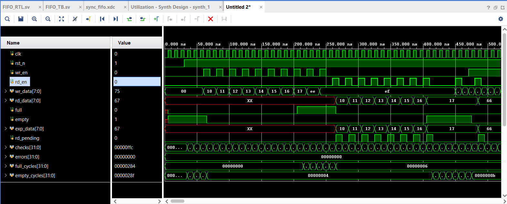
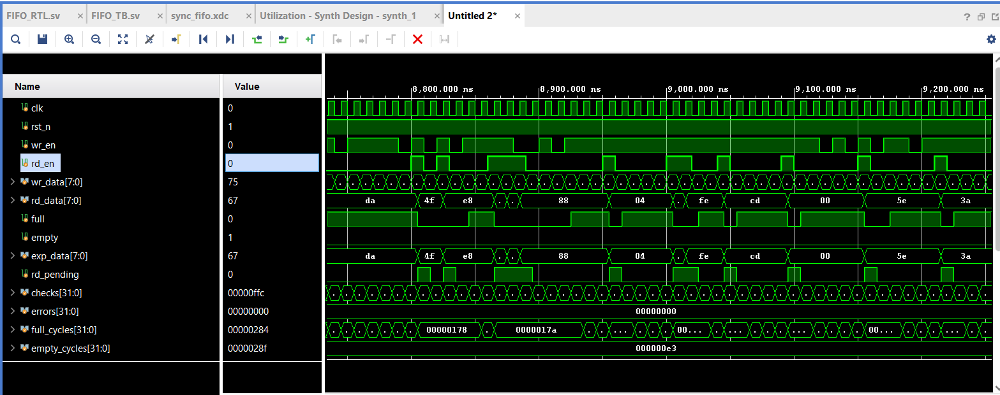
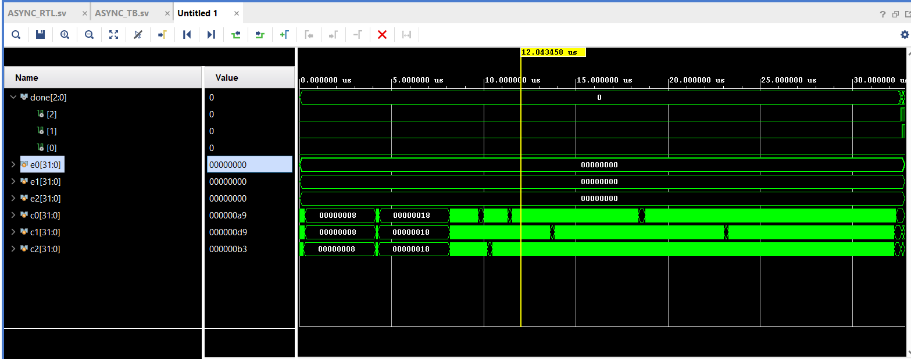

# FIFO Design and Verification in SystemVerilog

Parameterized **synchronous** and **asynchronous (clock-domain-crossing)** FIFOs with self-checking, queue-model testbenches. Both designs were simulated in Vivado, then taken through FPGA implementation (utilization, static timing) and, for the async FIFO, a CDC analysis.

## Results at a glance

All results are for `DATA_W = 8`, `DEPTH = 8`. Implementation numbers are post-route, Vivado 2024.2.

| | Synchronous FIFO | Asynchronous FIFO |
|---|---|---|
| Clocking | 1 clock, 10 ns (100 MHz) | write 10 ns (100 MHz), read 14 ns (71.4 MHz), declared asynchronous |
| Simulation | 4,092 checks, 0 errors | 4,923 checks, 0 errors (three clock ratios) |
| CLB LUTs | 15 (8 as distributed RAM) | 24 (8 as distributed RAM) |
| CLB registers | 16 | 40 |
| BRAM / DSP | 0 / 0 | 0 / 0 |
| WNS / WHS | +8.258 ns / +0.038 ns | +8.445 ns / +0.075 ns |
| CDC analysis | n/a | 16 crossing endpoints structurally safe, 0 unsafe |
| Target device | xck24-ubva530-2LV-c | xck26-sfvc784-2LVI-i |

The two designs were implemented on different devices, so resource counts are not a like-for-like comparison.

## Repository structure

```
SYNC_FIFO/
  RTL/          SYNC_FIFO_RTL.sv        module sync_fifo
  Testbench/    SYNC_FIFO_TB.sv         module sync_fifo_tb
  CONSTRAINTS/  sync_fifo.xdc           10 ns clock
  REPORTS/      utilization_post_impl.rpt, timing_post_impl.rpt
  WAVEFORMS/    simulation screenshots
ASYNC_FIFO/
  RTL/          ASYNC_FIFO_RTL.sv       module async_fifo
  Testbench/    ASYNC_FIFO_TB.sv        modules async_fifo_env, async_fifo_tb
  CONSTRAINTS/  async_fifo.xdc          10 ns / 14 ns clocks, asynchronous groups
  REPORTS/      async_utilization_impl.rpt, async_timing_impl.rpt
  WAVEFORMS/    simulation screenshots
```

---

## 1. Synchronous FIFO

### Design

- Single clock, parameterized data width and depth (`DEPTH` must be a power of 2).
- Memory array plus a write pointer and a read pointer. Each pointer has one extra MSB (the "lap" bit) so that full and empty can be told apart: the FIFO holds `0..DEPTH` items, which is `DEPTH + 1` states.
- `empty`: pointers fully equal. `full`: lower (address) bits equal and MSBs different.
- Operations are gated: a write is ignored when full, a read is ignored when empty, so no data is overwritten and the read pointer never passes valid data.
- Registered read data: `rd_data` is valid one clock after an accepted read.
- Synchronous active-low reset.

### Verification

A self-checking testbench with an independent reference model (a SystemVerilog queue updated only from the inputs, never from DUT flags). Every cycle it checks `full` and `empty` against the model's occupancy, and checks each read's data against the oldest model entry one cycle after the read.

Stimulus:
- Directed: fill to full, attempt extra writes (must be ignored), drain completely.
- 1,800 cycles of constrained-random traffic in alternating write-heavy and read-heavy phases, so the FIFO repeatedly reaches both full and empty.

Result: `checks=4092 errors=0`, `RESULT: PASS`, simulation ends at 18,480 ns.

Coverage counters printed by the testbench show that the corner cases were actually exercised:

| Counter | Value |
|---|---:|
| Cycles at full | 644 |
| Cycles at empty | 655 |
| Writes attempted while full (blocked) | 498 |
| Reads attempted while empty (blocked) | 505 |
| Simultaneous read/write at full | 92 |
| Simultaneous read/write at empty | 104 |
| Simultaneous read/write mid-fill | 84 |



*Directed fill and drain: eight writes (0x10 to 0x17) fill the FIFO and `full` asserts, the extra writes (0xEE, 0xEF) are ignored, and the reads return 0x10 to 0x17 in order.*



*Constrained-random traffic: `rd_data` tracks the scoreboard's `exp_data` and `errors` stays at 0.*

### FPGA implementation (post-route)

| Metric | Result |
|---|---:|
| CLB LUTs | 15 (7 as logic, 8 as distributed RAM) |
| CLB registers | 16 (4 write pointer + 4 read pointer + 8 read data) |
| BRAM / DSP | 0 / 0 |
| WNS (setup) | +8.258 ns |
| WHS (hold) | +0.038 ns |
| WPWS (pulse width) | +4.238 ns |
| TNS / THS / failing endpoints | 0 / 0 / 0 |

At this depth the memory is mapped to distributed (LUT) RAM, not block RAM.

---

## 2. Asynchronous FIFO

### Design

- Independent write (`wclk`) and read (`rclk`) clock domains, each with its own reset.
- Binary pointers address the memory. Their **Gray-coded** copies are the only signals that cross between domains, and each is registered before the crossing.
- Each Gray pointer passes through a **2-flop synchronizer** (marked `ASYNC_REG`) into the other domain.
- `empty` is generated in the read domain: next read Gray pointer equals the synchronized write Gray pointer.
- `full` is generated in the write domain: next write Gray pointer equals the synchronized read Gray pointer with its top two bits inverted ("same slot, one lap ahead").
- Both flags are registered and computed from the *next* pointer value, so they assert on the same edge as the operation that causes them.
- The synchronized pointers lag by about two clocks, so the flags are pessimistic but safe: `full` or `empty` may stay asserted slightly longer than necessary, but cannot fail to assert, so the FIFO never overflows or underflows.
- Registered read data: `rdata` is valid one `rclk` after an accepted read.

Only the pointers cross domains. The data goes through the dual-port memory and is not read until the synchronized write pointer shows that it was written.

### Verification

Three environments run in parallel, each with a different write/read clock ratio. Because the flags lag the true state, the testbench cannot predict them exactly. It follows what the DUT accepts and checks:

1. **No overflow:** a write is never accepted while the model holds `DEPTH` entries.
2. **No underflow:** a read is never accepted while the model is empty.
3. **Data order:** every accepted read returns the oldest written value.
4. **Settling:** after traffic stops and the FIFO is drained, the flags settle to empty and not full.

Stimulus per environment: write-only phase (must reach full), read-only phase (must reach empty), then alternating 85/15 and 15/85 write-heavy and read-heavy phases and a 50/50 phase, followed by a drain.

| Write / read clock | Checks | Errors | Writes = reads | Max occupancy |
|---|---:|---:|---:|---:|
| 100 MHz / 97.1 MHz (nearly equal, phase drifts) | 1,887 | 0 | 628 | 8 (full) |
| 71.4 MHz / 100 MHz (read faster) | 1,515 | 0 | 504 | 8 (full) |
| 100 MHz / 71.4 MHz (write faster) | 1,521 | 0 | 506 | 8 (full) |

Total: **4,923 checks, 0 errors**, `RESULT: PASS`, simulation ends at 32,820 ns.



*Scoreboard counters over the full run: `errors` stays at 0 in all three environments while the check counts rise, and the `done` flags go high when each environment finishes.*

### FPGA implementation (post-route)

| Metric | Result |
|---|---:|
| CLB LUTs | 24 (16 as logic, 8 as distributed RAM) |
| CLB registers | 40 |
| BRAM / DSP | 0 / 0 |
| WNS (setup) | +8.445 ns |
| WHS (hold) | +0.075 ns |
| WPWS (pulse width) | +4.238 ns |
| TNS / THS / failing endpoints | 0 / 0 / 0 |

### CDC analysis

Vivado `report_cdc` on the implemented design:

| Crossing | Endpoints | Classification |
|---|---:|---|
| `wclk` to `rclk` | 12 | Safe |
| `rclk` to `wclk` | 4 | Safe |
| Unsafe / unknown / missing `ASYNC_REG` | 0 | |

These are structural results: they confirm that every crossing goes through a recognized synchronizer. They are not a proof that metastability cannot occur.

---

## Reproducing the results

Tools: Vivado 2024.2.

1. Create a project and add the RTL file as a design source, the testbench as a simulation source, and the `.xdc` file under constraints.
2. Simulation top: `sync_fifo_tb` or `async_fifo_tb`. Run `run all` in the Tcl console. The testbench calls `$finish` and prints the report block.
3. Synthesis top: `sync_fifo` or `async_fifo`. Run synthesis and implementation, then `open_run impl_1` followed by `report_utilization`, `report_timing_summary` (and `report_cdc` for the async FIFO).

## Limitations and notes

- `DEPTH` must be a power of 2 (the Gray sequence wraps cleanly only for 2^n entries); the async FIFO needs `DEPTH >= 4`.
- RTL simulation has no wire delays, so it cannot show metastability or multi-bit skew. The CDC safety argument rests on the Gray-code and synchronizer structure and on the CDC report.
- The async constraints declare `wclk` and `rclk` asynchronous (`set_clock_groups -asynchronous`), so paths between the two clocks are not timed. The reported WNS and WHS cover paths inside each clock domain only. A stricter flow would bound delay and bus skew on the Gray pointer paths.
- Reset is applied per domain and must be held for at least 3 cycles of the slower clock. Reset synchronizers are not implemented.
- No input/output delay constraints were specified, so the timing figures are for internal register-to-register paths. Board-level timing would need I/O constraints.
- Results are specific to the chosen device and tool settings.
